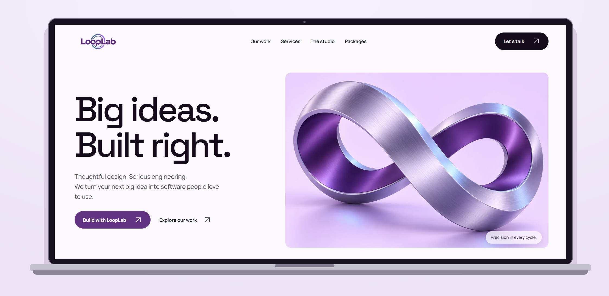
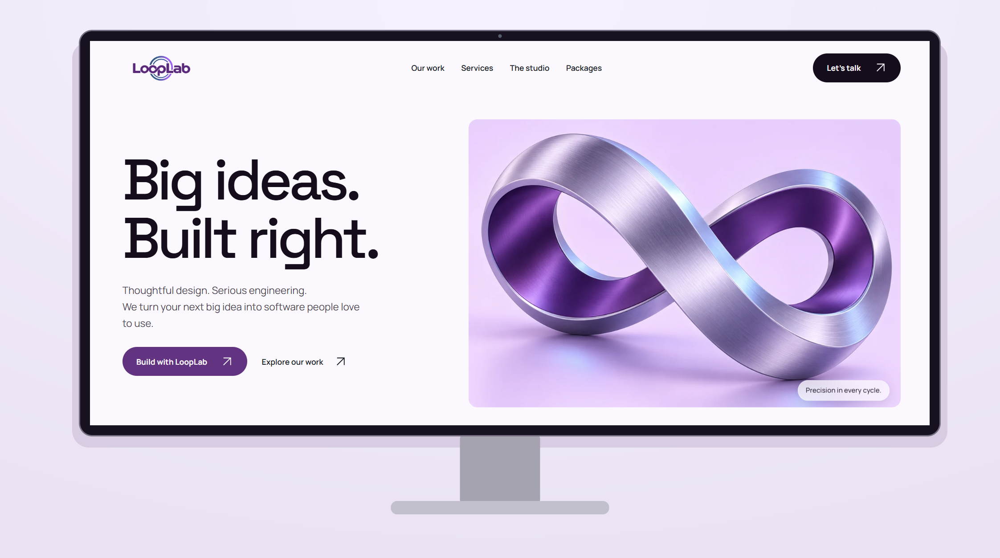

<p align="center">
  
</p>

<h1 align="center">Big ideas. Built right.</h1>

<p align="center">
  Thoughtful design. Serious engineering.<br />
  The company portfolio for <strong>LoopLab</strong>, built to turn curiosity into a conversation.
</p>

<p align="center">
  <a href="#the-experience">Explore</a> ·
  <a href="#run-it-locally">Get started</a> ·
  <a href="docs/LOGO_GUIDE.md">Brand & logo</a> ·
  <a href="docs/UAT-2026-10-25.md">Validation notes</a>
</p>



<p align="center"><strong>Precision in every cycle.</strong><br />A considered interface, from the first impression to the next conversation.</p>

## The experience

LoopLab brings its work, services, team and product options into one place. Visitors can explore projects, choose a direction and carry that context into a project enquiry.

| Discover | Decide | Connect |
| :--- | :--- | :--- |
| Filter the project gallery and explore the studio. | Browse seven product packages with monthly or full-project preferences. | Start a prefilled enquiry or contact the team directly. |
| Explore the technologies behind the work, including expandable AWS services. | Choose mobile app development with or without AI integration. | Apply by email when the careers feed is unavailable. |

### Designed to feel like LoopLab

- **A recognisable identity.** Sculptural loop artwork, a refined wordmark, purple accents and generous editorial typography.
- **Responsive by design.** A custom mobile and tablet menu, flexible layouts and readable forms.
- **Motion with purpose.** Page transitions, scroll reveals and a branded loading indicator, with reduced-motion support.
- **Details that finish the experience.** Custom favicon assets, a designed 404 page, legal navigation and clear form states.



<sub>Both mockups use the supplied homepage capture. The frames are illustrative, preserve the complete image and do not represent separate device test results.</sub>

## Explore the site

| Page | Route | What you will find |
| :--- | :--- | :--- |
| Home | `/` | Introduction, selected work and project entry points |
| Our work | `/projects` | Filterable project gallery and descriptions |
| Services | `/services` | Capabilities, project examples and technology logos |
| The studio | `/about` | Company story and approach |
| Packages | `/packages` | Product categories and enquiry preferences |
| Careers | `/careers` | Openings feed and direct email applications |
| Insights | `/blog` | Articles and ideas |
| Contact | `/contact` | Project enquiry form and contact channels |
| Privacy | `/privacy-policy` | Privacy information with section navigation |
| Terms | `/terms-of-service` | Terms with the same reading layout |

Candidate dashboard and OAuth callback routes are also present. Their live behaviour depends on the recruitment services. Unmatched routes show the custom 404 page.

## Under the hood

**React 19 · Vite 8 · React Router 7 · Tailwind CSS 3 · Motion 12**

Space Grotesk gives headings their character. Manrope keeps supporting text clear. Shared design tokens and reusable components keep the pages consistent, while secondary routes load on demand.

```text
src/
  components/       Shared navigation, loader, icons and layouts
  pages/            Public pages and recruitment account flows
  services/         Recruitment API integration
  projects.js       Project content
  studio.css        Portfolio styles and responsive refinements
public/             Brand assets, project imagery and technology logos
docs/               Design records, logo guide, mockups and validation notes
tools/              Reproducible documentation asset generation
```

## Run it locally

Use Node.js **22.12 or newer** and npm. From a terminal:

```bash
git clone https://github.com/looplab888-arch/LOOPLAB.git
cd LOOPLAB
npm ci
npm run dev
```

Open the local URL printed by Vite. It may select another port if the default is already occupied.

For connected features, create a `.env.local` file with values supplied by the project owner:

```dotenv
VITE_API_URL=https://your-recruitment-api.example/api
VITE_IMS_URL=https://your-recruitment-portal.example
VITE_FORMSPREE_ID=your-form-id
```

These are configuration placeholders. `VITE_` values are exposed to the browser, so never put private keys or passwords in them. Restart Vite after changing environment settings.

| Command | Purpose |
| :--- | :--- |
| `npm run dev` | Start local development |
| `npm run build` | Produce the production bundle in `dist/` |
| `npm run preview` | Preview the built site locally |
| `npm run lint` | Run ESLint |
| `node tools/make-mockups.js` | Rebuild both README device mockups |

When deploying, configure the host to serve `index.html` for client-side routes. Form delivery and recruitment flows require their respective external services.

## Brand, craft and documentation

| Document | Purpose |
| :--- | :--- |
| [Logo guide](docs/LOGO_GUIDE.md) | Refined wordmark, favicon assets and usage guidance |
| [Design system](DESIGN.md) | Palette, typography and interface decisions |
| [Product context](docs/PRODUCT.md) | Scope, audience and content constraints |
| [Implementation record](docs/IMPLEMENTATION.md) | Changes and technical notes |
| [Package discussion](docs/PACKAGES_DISCUSSION.md) | Commercial decisions still to be agreed |
| [Smoke tests and UAT](docs/UAT-2026-10-25.md) | Browser acceptance checks and known limits |
| [Mockup generation](docs/mockups/README.md) | Source image, output files and regeneration |

### Validation status

The recorded browser checks cover desktop, tablet and phone layouts, navigation, package prefills, contact form states, careers fallback, image fitting and 404 recovery. See the linked report for exact coverage. These are simulated acceptance checks, not a claim of stakeholder sign-off.

At the last recorded validation, the build passed and lint reported one existing hook-dependency warning in `CandidateDashboard.jsx`. The recruitment API was unavailable; real email delivery and authenticated recruitment flows were not verified. Package prices remain intentionally unpublished.

---

[MIT License](LICENSE) · Copyright 2026 Viraj Induruwa. Third-party marks identify their respective technologies or organisations; their inclusion does not imply endorsement.

<p align="center"><strong>LoopLab</strong><br />Precision in every cycle.</p>
