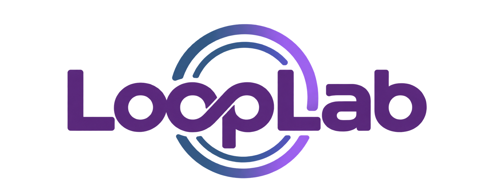

# LoopLab logo guide

The refined wordmark retains LoopLab's lettering, connected loop and orbital identity. Use the existing asset consistently rather than recreating the logo with a font.

## Choose the right asset

| Asset | Use |
| :--- | :--- |
| [Refined wordmark](../public/images/looplab-refined.png) | Website header, documentation and company presentations. Transparent raster PNG. |
| [Original logo](../src/assets/logo1.webp) | Original identity reference retained in the repository. |
| [Compact vector mark](../public/looplab-mark.svg) | Small-format identity, including favicon use. This is not a vector master of the wordmark. |
| [SVG favicon](../public/favicon.svg) | Browser tabs that support SVG icons. |
| [ICO fallback](../public/favicon.ico) | Multi-size browser fallback. |
| [Apple touch icon](../public/apple-touch-icon.png) | Home-screen icon on supported Apple devices. |
| [192px PNG](../public/favicon-192.png) | Raster icon use. A 96px variant is also available. |

## Recommended usage

- Preserve the asset's aspect ratio. Set width and allow height to scale automatically.
- Leave clear space of at least one quarter of the visible logo's height around it.
- Prefer the light brand surface behind the wordmark. On a dark canvas, use a light backing panel rather than recolouring the supplied pixels.
- At small sizes, use the compact mark instead of shrinking the full wordmark until the lettering becomes unreadable.
- Keep the logo separate from busy artwork and controls. Do not stretch, crop, rotate or add extra effects.
- For large-format print, obtain a dedicated vector wordmark master. Enlarging this PNG will not create vector detail.

## Brand foundations

| Role | Value |
| :--- | :--- |
| Primary purple | `#613380` |
| Purple container | `#7A4B9A` |
| Pale purple | `#F3DAFF` |
| Supporting blue | `#3C6184` |
| Dark ink | `#150C1C` |
| Main canvas | `#FBF9FD` |
| Display type | Space Grotesk |
| Body type | Manrope |
| Brand line | Precision in every cycle. |

These are interface tokens; preserve the supplied logo's own colours. The sculptural infinity artwork in the hero is supporting brand imagery, not a replacement for the company wordmark or favicon.

See the [design system](../DESIGN.md) for interface details. This guide describes asset use and does not establish trademark registration or grant rights to third-party marks.
